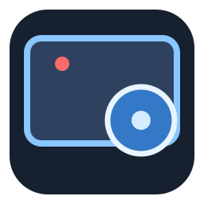
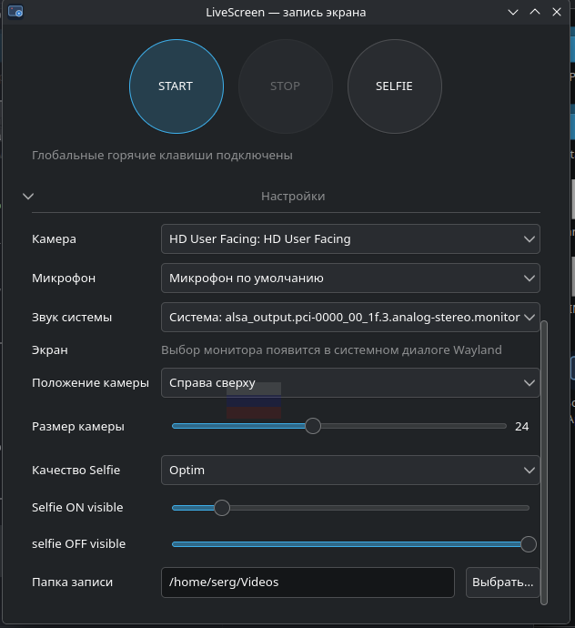

<p align="center">
  
</p>

<h1 align="center">LiveScreen</h1>

<p align="center">
  Запись экрана с камерой и звуком для Linux
</p>

<p align="center">
  
  
  
</p>

LiveScreen — небольшая программа для записи рабочего стола в MP4. Её главные фишки: **плавно появляющееся круглое selfie-окно поверх приложений**, быстрый отклик и низкая лишняя нагрузка на систему. Управление и lifecycle написаны на Rust, а захват и кодирование выполняет GStreamer.

Камера живёт отдельным desktop overlay и не встраивается в видео искусственно. Вы записываете экран таким, каким видите его сами: с камерой, окнами и курсором.

<p align="center">
  
</p>

## Что умеет

- 🎥 Пишет выбранный экран в MP4: H.264-видео и AAC-аудио.
- 🙂 Показывает камеру круглым окном поверх рабочего стола; тонкую рамку можно отключить в настройках.
- ✨ Плавно скрывает и возвращает selfie без рывков.
- 🖱️ Позволяет перетаскивать selfie мышью; правый клик запускает запись или ставит её на паузу, а скрытое окно пропускает клики насквозь.
- 🎙️ Записывает микрофон и системный звук, микрофон можно отключить кнопкой `MUTE`.
- ⏯️ Поддерживает паузу и продолжение без создания нескольких файлов.
- ⌨️ Работает с глобальными горячими клавишами через desktop portal.
- 🔢 Показывает click-through отсчёт `2 → 1 → Rec` перед началом записи и короткие статусы `Paused`, `Rec`, `STOP`.
- 📦 Собирается в один AppImage.

Основной сценарий проверен в Ubuntu/KDE Plasma на Wayland. Для захвата экрана используется системный `xdg-desktop-portal`, поэтому разрешение остаётся под контролем пользователя. LiveScreen запрашивает только полный монитор: отдельные окна и virtual sources в диалоге не предлагаются. Для X11 есть fallback через `ximagesrc`.

## Быстрый старт

Понадобятся стабильный Rust toolchain, GTK4, GTK4 Layer Shell, GStreamer с PipeWire/PulseAudio/V4L2 и работающий `xdg-desktop-portal`.

```bash
git clone https://github.com/nicelight/livescreen.git
cd livescreen
cargo run
```

Проверить окружение без открытия основного интерфейса:

```bash
cargo run -- --diagnose
```

При первом запуске LiveScreen создаёт desktop entry в `~/.local/share/applications`, чтобы portal мог корректно идентифицировать приложение.

## AppImage

```bash
./scripts/build-appimage.sh
./LiveScreen-x86_64.AppImage
```

Скрипт собирает release-бинарь, добавляет нужные GTK/GStreamer runtime-файлы и создаёт `LiveScreen-x86_64.AppImage` в корне проекта. Внешние инструменты упаковки скачиваются в локальную папку `tools/`.

## Управление

| Действие | Кнопка | Комбинация по умолчанию |
|---|---|---|
| Начать / пауза / продолжить | `START` / `PAUSE` / `RESUME` | `Ctrl+Alt+R` |
| Остановить и сохранить | `STOP` | `Ctrl+Alt+F` |
| Показать или скрыть selfie | `SELFIE` | `Ctrl+Alt+O` |
| Отключить микрофон | `MUTE` | `Ctrl+Alt+M` |

Комбинации можно поменять через стандартное окно Global Shortcuts. Нажмите на нужную комбинацию в разделе «Настройки» — новые значения применятся сразу и сохранятся между запусками.

У активного selfie левая кнопка отвечает за перетаскивание и плавное скрытие, правая — за `START`, `PAUSE` и `RESUME`. Во время перехода прозрачности selfie становится click-through и не принимает команды мыши.

## Как это работает

```text
камера → V4L2 / GStreamer → GTK Layer Shell overlay ─┐
                                                      ├→ compositor → portal / PipeWire → H.264
микрофон + системный звук → PulseAudio / PipeWire ───┘                              ↓
                                                                                  MP4 + AAC
```

Камера не дублируется внутри recording pipeline. Это оставляет архитектуру проще: preview и overlay отвечают только за изображение камеры, recorder — только за захват уже скомпонованного рабочего стола и звука.

Долгие операции portal и GStreamer выполняются вне GTK main thread. При остановке recorder отправляет EOS, дожидается финализации контейнера и только после этого сообщает, что MP4 сохранён.

## Настройки и логи

Пользовательские настройки:

```text
~/.config/livescreen/settings.json
~/.config/livescreen/config.json
```

Логи:

```text
~/.local/share/livescreen/logs/livescreen.log.YYYY-MM-DD
```

Для подробного диагностического запуска:

```bash
./scripts/run-debug.sh
```

Скрипт складывает stdout, stderr, GStreamer log и DOT-графы pipeline в отдельный каталог `/tmp/livescreen-debug.*`.

## Разработка

```bash
cargo fmt -- --check
cargo check
cargo test
cargo clippy --all-targets -- -D warnings
```

Навигация по модулям, lifecycle и runtime-контрактам собрана в [`index-codebase.md`](index-codebase.md). Правила для coding-агентов находятся в [`AGENTS.md`](AGENTS.md), а короткая памятка по диагностике — в [`DEBUGGING.md`](DEBUGGING.md).

## Известные ограничения

- Основная поддерживаемая среда — Ubuntu/KDE Wayland; X11 остаётся best-effort fallback.
- Camera overlay сейчас привязан к первому GDK-монитору, а экран для записи выбирается отдельно в системном portal.
- Набор доступных камер и аудиоисточников зависит от V4L2, PipeWire/PulseAudio и установленных GStreamer plugins.

## Лицензия

MIT — подробности в [`LICENSE`](LICENSE).
